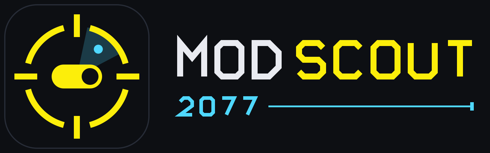
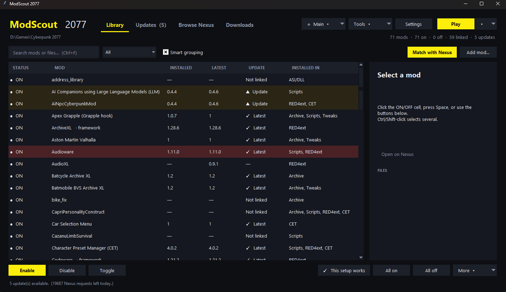
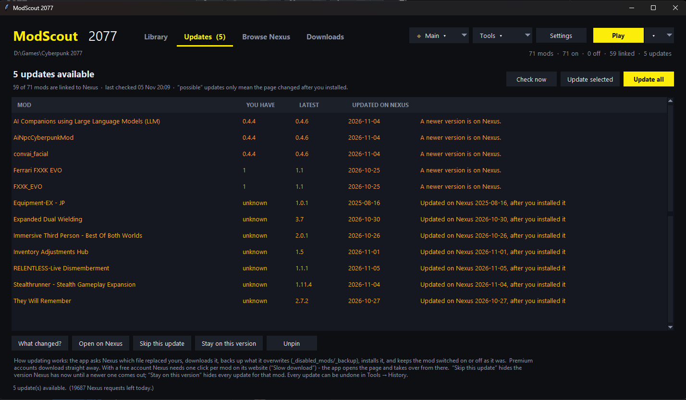
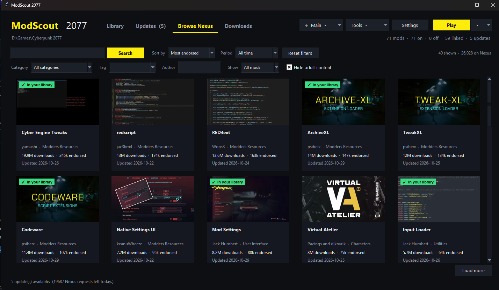
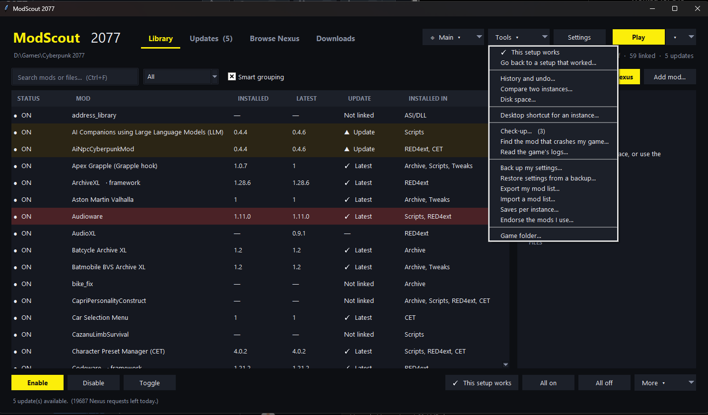
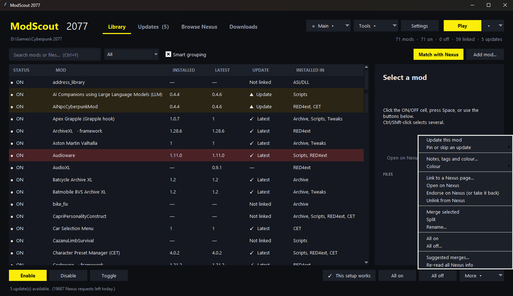

# ModScout 2077

<p align="center">
  <strong>A smarter way to manage your Cyberpunk 2077 mod collection.</strong><br>
  Find manually installed mods, identify their Nexus pages, manage updates, and switch between mod setups — from one Windows app.
</p>

<p align="center">
  
</p>

## Screenshots

<p align="center">
  
  <br><em>Library — scan, search, organize and toggle your installed mods.</em>
</p>

<p align="center">
  
  <br><em>Updates — compare installed versions with available Nexus versions.</em>
</p>

<p align="center">
  
  <br><em>Browse Nexus — discover mods without leaving the application.</em>
</p>

<p align="center">
  
  <br><em>Tools — access instance management, history, backups and troubleshooting.</em>
</p>

<p align="center">
  
  <br><em>Mod actions — manage links, updates, notes, colours and grouping.</em>
</p>


<p align="center">
  <a href="https://github.com/yasssssssin/ModScout-2077-Mod-Manger-cyberpunk-2077/blob/main/LICENSE"></a>
  
  
  
</p>

## Get ModScout

ModScout is distributed as a single Windows executable. Download the Windows executable from the **[GitHub Releases page](https://github.com/yasssssssin/ModScout-2077-Mod-Manger-cyberpunk-2077/releases)** when a release is published.

To build it yourself, follow the instructions below. The repository intentionally contains the source and build script rather than generated PyInstaller output.

## Features

- **Finds manually installed mods.** Scans common Cyberpunk 2077 mod locations and groups related files into mod entries.
- **Matches mods to Nexus Mods.** Uses conservative automatic matching; uncertain matches are presented as candidates for you to verify.
- **Checks for updates.** Shows available updates for linked mods and can install the appropriate file.
- **Installs mods.** Add a downloaded archive and let ModScout identify and install it.
- **Enables and disables mods.** Switch individual mods or whole collections on and off.
- **Uses instances.** Save named mod setups and switch between them.
- **Keeps a history.** Review changes and undo supported installs, updates, and switching operations.
- **Checks your setup.** Looks for common installation problems, missing frameworks, conflicting files, and other warnings.
- **Helps investigate crashes.** Its mod-isolation workflow can narrow down which installed mod may be causing a problem.
- **Includes extra tools.** Export/import mod lists, back up supported settings, inspect selected game logs, compare instances, and more.

Features that interact with Nexus Mods require your own Nexus Mods API key. Browse images use the optional Pillow library; without it, the app still works, but some images may not display.

## First-launch guide

New to ModScout? Read the **[First-Launch Guide](FIRST-LAUNCH-GUIDE.md)** for help locating your game folder, getting a Nexus API key, scanning existing mods, using instances, and backing up or restoring settings.

## Build from source (Windows)

### Requirements

- Windows
- Python 3.10 or newer recommended
- Internet access for installing build tools

### Build

1. Install Python from [python.org](https://www.python.org/downloads/) and enable **Add Python to PATH** during setup.
2. Download this repository using **Code → Download ZIP**, then extract it.
3. Keep `cp2077_mod_toggle.py`, `build_exe.bat`, and `modscout.ico` together in the extracted folder.
4. Double-click `build_exe.bat`.
5. When the build finishes, find `ModScout2077.exe` in the generated `dist` folder.

The build script installs PyInstaller and attempts to install Pillow. Pillow enables mod images in Browse Nexus; if it cannot be installed, the application still builds with reduced image support.

You can also run the Python application directly:

```powershell
python cp2077_mod_toggle.py
```

## Nexus Mods API key

Use your own Nexus Mods API key in the app's settings. The application stores its configuration locally in `~/.cp2077_mod_toggle.json` and sends the key to the Nexus Mods API when needed.

**Never share this configuration file or publish your API key.** If you accidentally expose a key, revoke it in your Nexus Mods account and create a replacement.

## Repository layout

```text
.
├── cp2077_mod_toggle.py   # Application source
├── build_exe.bat          # Builds the Windows executable
├── modscout.ico           # Application icon used by the build script
├── README.md
├── LICENSE
├── SECURITY.md
└── .gitignore
```

PyInstaller generates `build/` and `dist/` when you run the build script. These are build artifacts and are intentionally excluded from source control.

## Safety notes

- Back up your Cyberpunk 2077 folder and mod configuration before making large changes.
- Review candidate Nexus matches rather than accepting a guess.
- Keep your own backups before making large-scale changes to a mod setup.
- Never include API keys, personal paths, or private configuration in public issues or screenshots.
- ModScout is a community project and is not affiliated with CD PROJEKT RED or Nexus Mods.

## Feedback and bug reports

Found a bug or have an idea? [Open a GitHub issue](https://github.com/yasssssssin/ModScout-2077-Mod-Manger-cyberpunk-2077/issues). Include your Windows version, ModScout version, what you expected, what happened, and relevant error text. Remove API keys and private information from logs before posting.

## License

ModScout 2077 is released under the [MIT License](LICENSE).
